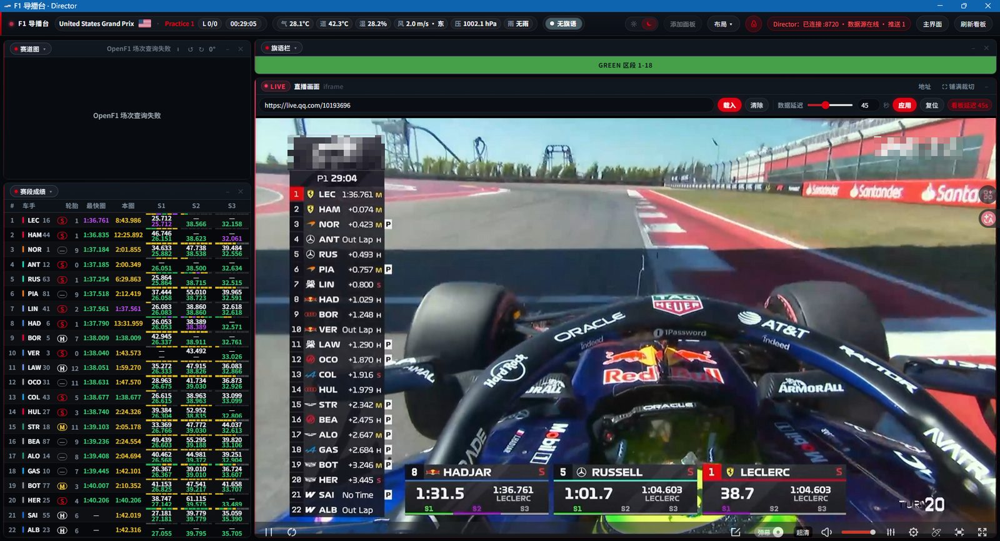
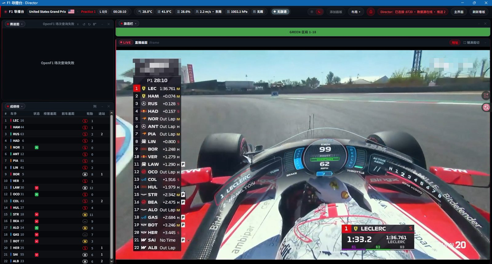
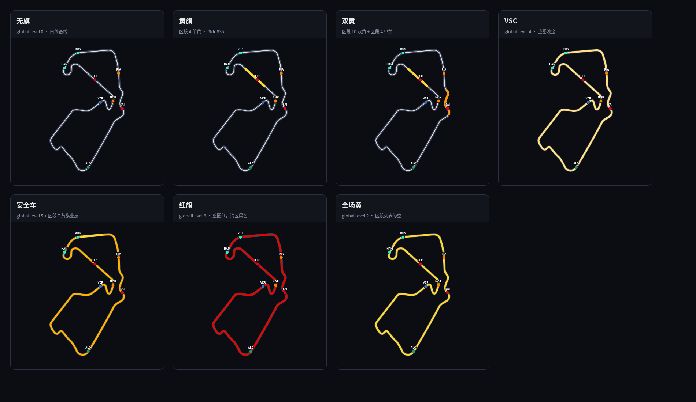
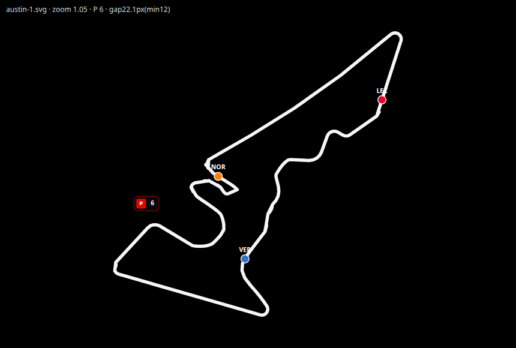
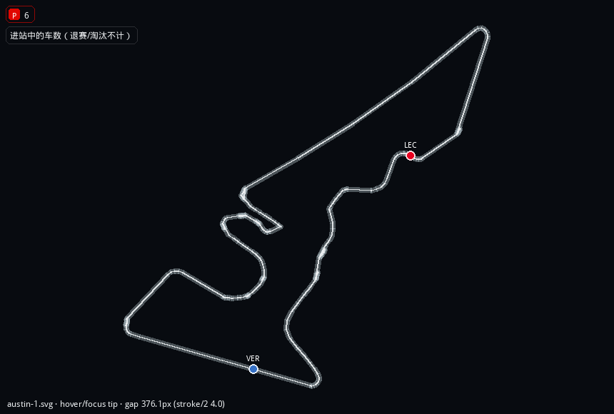
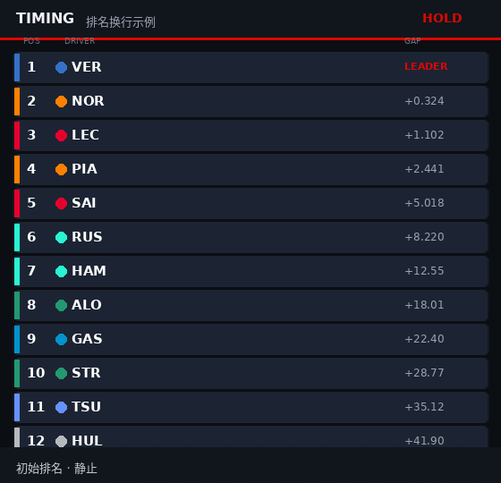

# F1 导播台 / F1-Director

把官方赛时数据摊成可拖拽的导播台：成绩榜、赛段、天气、赛道图、轮胎与车手圈等，本机一键开跑。

**项目名称：** F1 导播台 / F1-Director  
**壳层版本：** [`VERSION`](VERSION) 当前为 **0.2.7+20261024**（只标识本导播台壳；内嵌时序 jar 仍为 **0.1.15_modify**，勿与壳版本混读）

---

## 效果图

美国站练习赛。成绩榜（含赛段）、赛道图和直播车载画面排在一起；顶栏是场次、剩余时间和天气，直播条上可以设数据延迟。

另一套布局：成绩榜收在左侧，直播铺开，地址栏可以收起。

图里赛道图还是旧界面的「OpenF1 场次查询失败」。**当前版本不再请求 OpenF1**：轮廓只用本地 f1db SVG，车位是计时估计（不是官方 GPS）。下面才是我们自己做的赛道图。

估计赛道图旗语上色（银石，全部旗况）：本地 SVG + 已有 `track.yellowSectors` / `doubleYellowSectors` / `globalLevel`，黄 / 双黄 / VSC / 安全车 / 红旗 / 全场黄。不请求 OpenF1。同一张图也在 [`docs/trackmap-flags-silverstone.png`](docs/trackmap-flags-silverstone.png)。

进站 P 徽章：`inPit` / 差距含 PIT 的车不画在轮廓上，也不再摊车队色点。赛道图视口左上角只留一块紧凑徽章：红底「P」+ 当前进站人数；人数为 0 时隐藏。悬停或聚焦可看「进站中的车数（退赛/淘汰不计）」。出站后车点回线。示意是默认 zoom 1.05 的估计图，不是真实维修区几何。

奥斯汀：P 徽章钉在面板左上角。

悬停 / 聚焦徽章时的说明：「进站中的车数（退赛/淘汰不计）」。

排名换行：成绩榜和赛段成绩在名次变化时，整行按车号滑到新位置（FLIP / `translateY`，约 **320ms** ease），而不是一帧跳变。多车同时换位也会一起动；POS（以及成绩榜的差距列）等落到新位置后再改。`prefers-reduced-motion` 时跳过动画、直接落位。这和 jar 下发的掉位闪烁 / ↓N（drop5 / drop10 / flash）是两套效果，互不影响。

Rank swap: both the main timing board and the sector board slide rows to their new places when positions change (FLIP / `translateY`, ~320ms ease) instead of jumping. Multi-car reshuffles animate together; POS (and timing gap/interval) update after the slide lands. `prefers-reduced-motion` skips the motion. Separate from the jar’s drop5/drop10/flash blink + ↓N.

---

## 和原版的关系

本仓库是对 [F1-RaceControl-Desktop](https://github.com/Xixixiao2007/F1-RaceControl-Desktop) 的**壳层增强**，不是重写整条时序链路。

| 层级 | 来源 | 说明 |
|------|------|------|
| 时序引擎（SignalR → HTTP/SSE、本地 jar） | 上游 + 本地 `_modify` 补丁 | `share/F1-RaceControl-Desktop-0.1.15_modify.jar` |
| 导播台壳（`director.html`、布局、UI 覆盖） | 本仓库 | 启动时发布到 `share/web/`，与 jar 同端口 |

上游主仓：[Xixixiao2007/F1-RaceControl](https://github.com/Xixixiao2007/F1-RaceControl)（MIT）。Desktop 发行说明见其 GitHub Releases。

---

## 致谢

| 角色 | 谁 | 做什么 |
|------|-----|--------|
| 思路 / 产品方向 | **Ryan** | 导播台形态、交互与效果目标 |
| 壳层实现 | **Lumi**（助手 / Grok Bot） | 导播台页、启动脚本、布局持久化、UI 与补丁整合 |
| 启动器图标 | **Lumi** | 透明底赛车剪影 + 描边（`director/assets/F1-Director.ico`，并嵌入 `启动导播台.exe` / 浏览器标签图标） |
| 原版 Race Control | [Xixixiao2007](https://github.com/Xixixiao2007/F1-RaceControl-Desktop) | 官方/社区赛时数据管线与本地方案 |

对外介绍时请写清：**想法归 Ryan，壳层实现归 Lumi，时序底座归上游。**

---

## 开源协议

本仓库壳层（`director/` 下脚本、导播台页、UI 覆盖等）为 **MIT**，见 [`LICENSE`](LICENSE)，版权声明：`Copyright (c) 2026 Ryan / F1 导播台`。

| 项目 | 协议 | 链接 |
|------|------|------|
| F1-RaceControl（时序源码） | MIT · Copyright (c) 2026 Xixixiao2007 | https://github.com/Xixixiao2007/F1-RaceControl |
| F1-RaceControl-Desktop | 以该仓说明为准；时序底座与上表同源 | https://github.com/Xixixiao2007/F1-RaceControl-Desktop |

再分发时请保留本仓 `LICENSE`，并致谢上游 MIT；`share/` 内 jar / JRE 按上游与本仓约定使用，勿单独当成「纯本仓 MIT 二进制」对外宣称。

---

## 怎么运行

1. **推荐：** 双击项目根目录 **`启动导播台.exe`**  
   - 资源管理器里直接显示赛车图标（图标已嵌进 exe，无需再生成 `.lnk`）  
   - 浏览器导播台标签 / Edge 应用窗也会用同一套 favicon（`director/assets/`）
2. 也可以双击 `director\Start.cmd`（无自定义图标）。
3. 脚本会：停掉旧实例 → 把 `director/` UI 发布到 `share/web/` → 用 `share/jre` 拉起 jar（端口 **8720**）→ 用 Edge/Chrome `--app=` 打开导播台。
4. **关掉导播台标签/窗口后约 3 秒**会停 jar（`pagehide` → `/goodbye`）。F5 刷新不会误杀。若标签异常消失，约 **10 秒**无心跳也会停服（心跳间隔 **6 秒**）。也可随时 `director\Stop.cmd`。

端口：

- 导播台页 / API：`8720`
- 生命周期心跳：`8721`（仅本机）

不要直接双击 `director.html`（`file://` 下 SSE/心跳不可用）。

若要把快捷方式放到桌面：对 `启动导播台.exe` 选「发送到 → 桌面」，图标会跟着 exe 走。

---

## 目录结构

| 路径 | 说明 |
|------|------|
| `启动导播台.exe` | 根目录启动器（内嵌图标 → 调 `director\Start.cmd`） |
| `director/` | 导播台源：页面、脚本、UI 覆盖 |
| `director/Start.cmd` | 实际启动入口 |
| `director/Stop.cmd` | 强制停 jar、释放 `:8720` |
| `director/director.html` | 导播台主页面 |
| `director/web-override/` | 覆盖 UI（`app.js` / `rank-swap.js` / `style.css` / 状态 SVG 等） |
| `director/web-override/circuits/` | 本地赛道轮廓 SVG（f1db，不联网） |
| `docs/` | 效果图、估计赛道图旗语拼图、进站 P 区示意、排名换行 GIF |
| `director/layouts.json` | 首次布局种子（写入 `share/web/layouts.json` 后以运行时为准） |
| `director/assets/` | 图标源与 favicon（`F1-Director.ico`、浏览器图标） |
| `director/Publish-Web.cmd` | 把 UI（含 assets）拷到 `share/web/` |
| `share/` | 运行时：jar + JRE + 已发布 `web/`（JRE/web 默认不进 Git） |
| `share/F1-RaceControl-Desktop-0.1.15_modify.jar` | 带本地补丁的时序包 |
| `VERSION` | 壳层版本号 |
| `.gitignore` | 忽略 `share/jre/`、`share/web/`、本地 `*.lnk` 等 |

---

## 主要功能（当前）

- 可拖拽多面板：成绩榜、赛段成绩、赛道图、天气、实时流等；布局可锁定（锁定后仍可切换预设，不可重置/删预设）
- 切换布局时**沿用正在播的直播面板**（整块面板留在页面里，只改位置和尺寸；iframe / video 不拆走、不重新载入，也不必再点一次播放）
- 看板数据延迟只推迟四周看板和左上角场次，**不改变直播画面**。秒数记在本标签的 sessionStorage：关掉标签即丢，同一标签刷新还在。启动时清掉旧的 localStorage 延迟，避免上一场的缓冲留到下次打开
- 日/夜主题：按钮点击处约 **1s** 圆形扩散切换（View Transition）；启动读盘与布局预设仍瞬时切主题；`prefers-reduced-motion` 时跳过动画
- 顶栏剩余时间：jar 按官方 `Extrapolating`/`Utc` **本地外推**；SSE **至少 1Hz** 推送；秒级向上取整，减轻跳秒
- 赛段 S1–S3：紫/绿/黄（总最佳 / 个人最佳 / 更慢），迷你赛段条与可选 +delta
- 赛道图车位是**估计**：轮廓只读 `director/web-override/circuits/` 里的本地 f1db SVG，不请求 OpenF1，也不用官方 GPS。练习 / 排位沿赛段和迷你赛段，正赛用相对领先者的时间差。进站车（`inPit` / 差距含 PIT）不画在轮廓上，只计入视口左上角「P + 人数」徽章；出站后回线。顶栏只有红色「估计」和旋转。对不上的赛道写「未识别赛道」，不联网。已知赛道的进度 0 用 `CIRCUIT_PHASE` 对到计时线。P 徽章、安全车和起跑线对齐都不是真实几何。细节见 [`director/TRACKMAP.md`](director/TRACKMAP.md)
- 赛道图旗语：用现有 `track.yellowSectors` / `doubleYellowSectors` 把轮廓等分成裁判区段来上色（黄 / 深黄）。红旗、安全车、虚拟安全车给整圈上色。没有弯道实测桩位。预览见上方效果图
- 轮胎扁圆徽章；成绩榜与**赛段成绩**斑马纹（`tbody` 兼容选择器）；强调色 F1 红 `#e10600`
- 成绩榜 / 赛段成绩排名换行：名次变了时按车号 FLIP 滑动（约 320ms），POS 落位后再改；`prefers-reduced-motion` 跳过。不是 jar 的 drop/flash 掉位闪烁
- 轮胎 `Compound`：官方 Stints 增量常只推圈数、不带胎种；jar `deepMerge` 不再用空 Compound 盖掉旧值，读胎种自新到旧扫 stint 并 sticky 最近一次非空，避免成绩榜灰色 `—`
- 正赛预设种子：成绩榜略增高、赛道图略减矮（`director/layouts.json`）
- 天气顶栏：气温、赛道温、湿度、风速风向（中文方位）、气压 hPa、降雨文案；悬停分项提示
- 状态列 SVG：进站 / 出站 / 停止 / 退赛 / 出局等
- 页面关闭自动停服；心跳 **6s**，告别宽限约 **3s**，失联兜底约 **10s**
---

## 开发与发布备注

- 改 `director/web-override/` 或 `director.html` 后跑一次 `director\Publish-Web.cmd`，或直接再开 `启动导播台.exe`（启动流程会发布）。
- 排名换行自测：`node director/web-override/rank-swap.test.js`；界面上换位成绩榜或赛段成绩里任意两车的 POS 应看到整行滑动。
- `share/web/` 为生成物，以 `director/` 为源。
- 内嵌 jar（`share/F1-RaceControl-Desktop-0.1.15_modify.jar`）含本地补丁：顶栏剩余时间外推 + SSE ≥1Hz 推送、Stints `Compound` sticky / `deepMerge` 保胎种等；壳层版本见 `VERSION`，勿与 jar 标号混读。
- 合并进 `main` 请用 **`git merge --no-ff`**，不要快进合并。
- 分支命名：`{base}_{content}`（如 `main_timingWeatherCache`）。
- 带 JRE 的「解压即用」包请走 GitHub Release 单独 zip；仓库保持苗条（不提交 `share/jre`、`share/web`）。
---

## 相关链接

- 本仓：https://github.com/Ryan-1021/F1-Director  
- 上游 Desktop：https://github.com/Xixixiao2007/F1-RaceControl-Desktop  